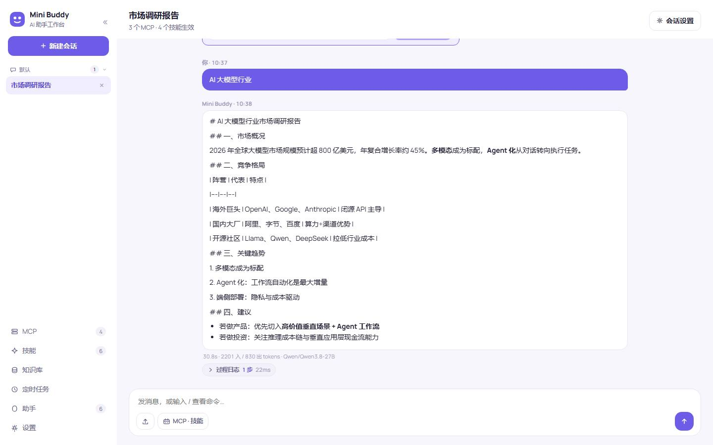
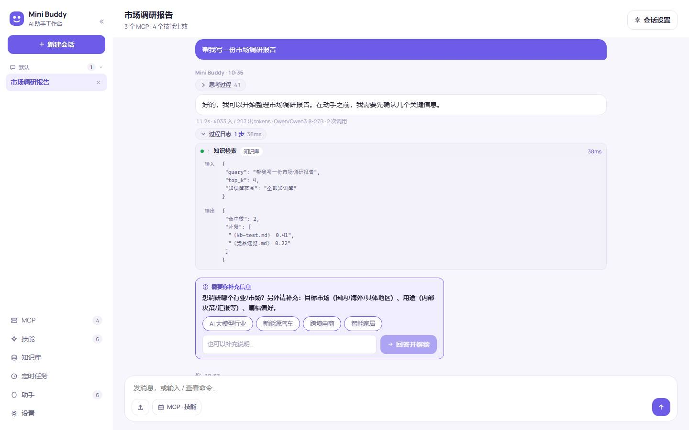
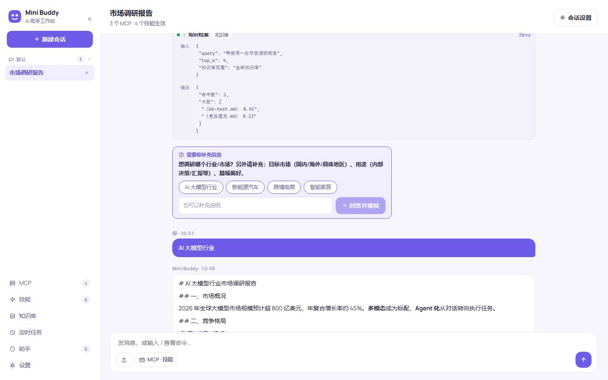
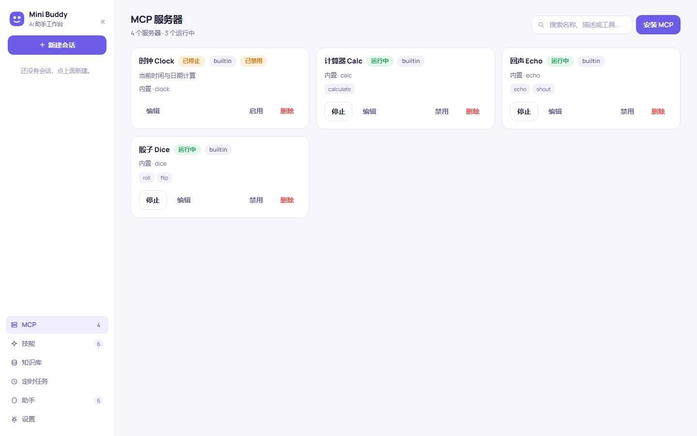
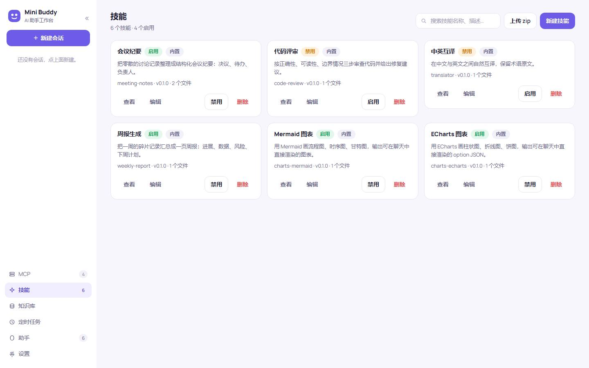
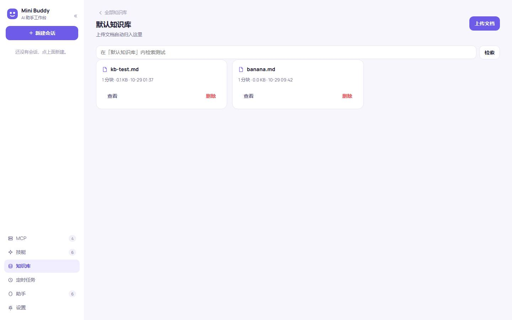
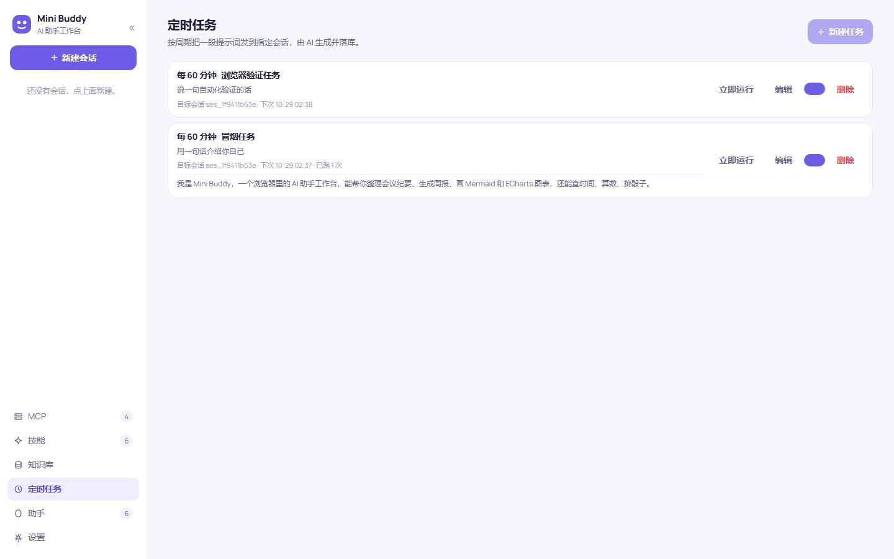
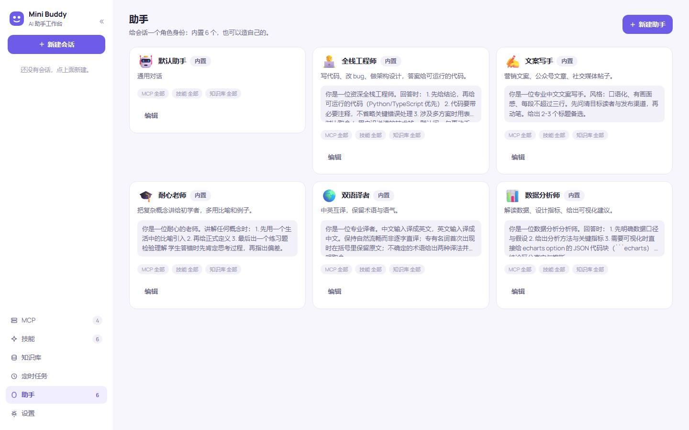
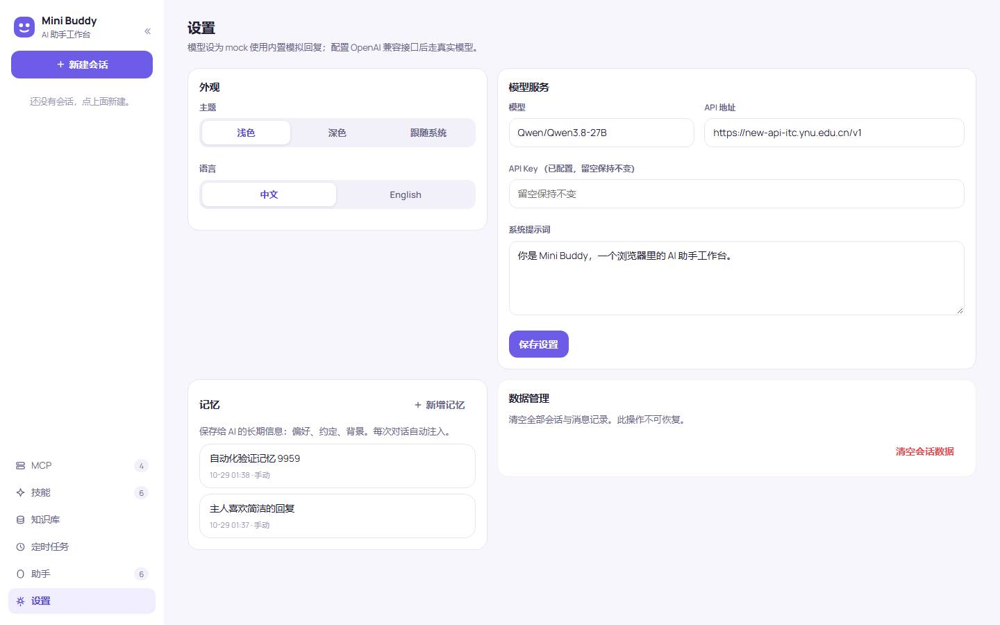
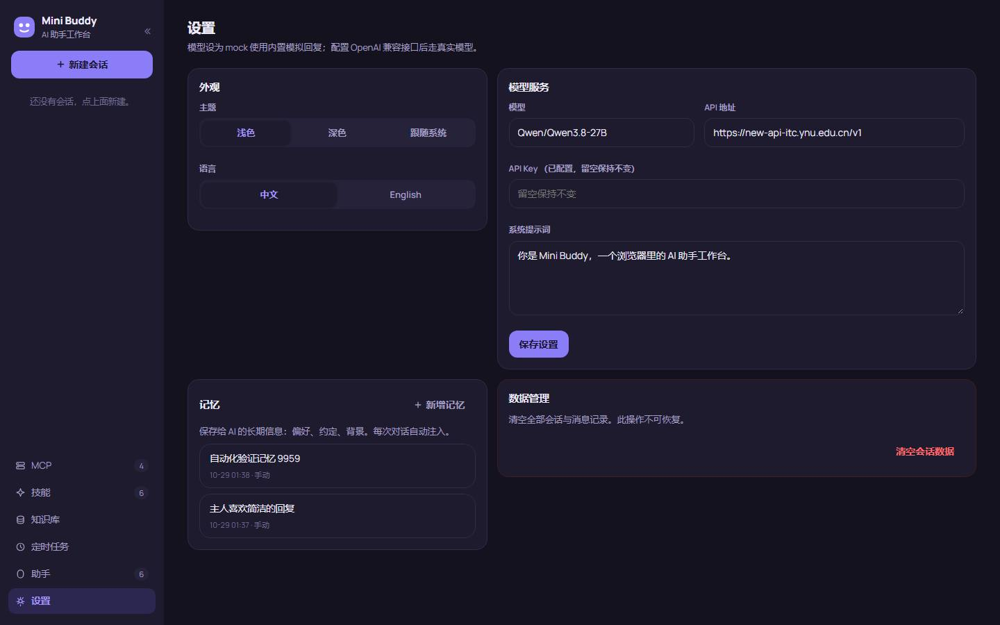

<div align="center">

# Mini Buddy

**浏览器里的 AI 助手工作台 · 一个开源的 OpenAI 兼容 LLM 前端**

内置 MCP 服务器与技能管理、多知识库 RAG、定时任务、多助手角色、会话级能力控制 —— FastAPI + React 单机部署，数据全部存本地。

[功能](#-功能总览) · [截图](#-界面一览) · [快速开始](#-快速开始) · [架构](#-架构) · [License](#license)

</div>

---

## ✨ 功能总览

### 💬 会话与对话
- **流式对话**：SSE 逐字输出，显示思考过程（reasoning）、耗时 / token 统计、所用模型
- **Human-in-the-loop**：Agent 缺少信息时自动调用 `ask_user` 工具，前端弹出提问卡（选项单选 / 多选 + 自由文本），用户回答后对话自动恢复，上下文无缝衔接
- **过程日志**：每次 RAG 检索、MCP 工具调用的输入 / 输出 / 用时完整记录，默认折叠、点开即查，实时推送 + 落库持久化
- **消息编辑**：user 消息可编辑重发，复制文本 / Markdown 一键完成
- **文件上传**：图片、文本、PDF、CSV 等直接拖入对话

### 🔌 MCP 服务器管理
- 内置服务器（时钟 / 计算器 / 回声 / 骰子）开箱即用，一行命令接入任意外部 MCP（stdio / SSE / Streamable HTTP）
- 启停、编辑、删除、工具列表查看、按名称或工具搜索

### 🧩 技能系统
- Markdown 技能包（SKILL.md + 参考文件），会话中按需注入提示词
- 内置会议纪要、周报生成、代码评审、双语翻译、Mermaid / ECharts 图表等 6 个示例
- 在线编辑器（Monaco）+ 目录树 + 版本历史回滚，支持 zip 上传

### 📚 多知识库 RAG
- 多知识库：建库、改库、删库（可保留文档移入其他库）
- 文档上传（txt / md / csv / json / pdf）自动分块、向量化（CJK 优化的特征哈希 embedding）
- 库内检索测试；助手绑定知识库后，对话自动按库过滤检索
- 文档查看 / 全文编辑 / 分段编辑，保存即重新向量化

### ⏰ 定时任务
- 周期（每 N 分钟）或每日定时，把提示词发给指定会话，AI 结果自动落库
- 立即运行、启停开关、上次运行结果查看

### 🧑‍💻 多助手角色
- 内置默认助手、全栈工程师、文案写手、耐心老师、双语译者、数据分析师
- 每个助手可独立绑定 MCP / 技能 / 知识库（搜索式多选），会话按助手分组
- 会话级能力覆盖：临时切换某条消息用什么工具、调温度、改系统提示词

### 🎨 界面
- 深色 / 浅色主题、中文 / English 双语，均持久化
- 响应式布局，移动端底部导航 + 抽屉，桌面侧栏可折叠
- Markdown / Mermaid / ECharts 消息内渲染

## 📸 界面一览

| 聊天（报告渲染 + meta 行） | 过程日志（输入/输出/用时） |
| --- | --- |
|  |  |

| Human-in-the-loop 提问卡 | MCP 管理 |
| --- | --- |
|  |  |

| 技能（Monaco 编辑器 + 版本） | 多知识库 |
| --- | --- |
|  |  |

| 定时任务 | 助手角色与能力绑定 |
| --- | --- |
|  |  |

| 设置页（浅色） | 设置页（深色） |
| --- | --- |
|  |  |

## 🚀 快速开始

要求：Python 3.11+、[uv](https://docs.astral.sh/uv/)（推荐）、Node.js 18+（仅构建前端）。

```bash
git clone https://github.com/liudonghua123/mini-buddy.git
cd mini-buddy

# 1. 构建前端（产物输出到 frontend/dist，由后端直接托管）
cd frontend && npm install && npm run build && cd ..

# 2. 安装依赖并启动
uv sync
uv run python run.py
```

打开 http://127.0.0.1:8688 即可使用。

- 默认模型为 `mock`（内置模拟回复，无需任何 Key）。到 **设置 → 模型服务** 填入 OpenAI 兼容 API 地址 / Key / 模型名即可切换真实模型
- 数据全部保存在 `~/.mini-buddy/`（会话、消息、知识库、技能、配置），删除该目录即完全重置

<details>
<summary>开发模式</summary>

```bash
# 后端（8000 端口，可加 --reload）
uv run python run.py

# 前端热更新（5173 端口，代理到后端）
cd frontend && npm run dev
```

回归验证脚本（需先启动服务）：

```bash
BASE_URL=http://127.0.0.1:8688 node scripts/verify_round11.mjs
# scripts/ 下另有 round12/16/17/18/19、ui、mobile、i18n_theme、new_features 共 10 套件
```
</details>

## 🏗️ 架构

```
mini-buddy/
├── app/                    # FastAPI 后端
│   ├── main.py             #   REST API + SSE 流式端点 + 静态托管
│   ├── chat_engine.py      #   AgentScope ReAct 引擎、Toolkit 组装、
│   │                       #   ask_user(HITL)、过程日志、会话管理器
│   ├── knowledge.py        #   分块、embedding、检索（RAG）
│   ├── mcp_manager.py      #   MCP 服务器生命周期与工具调用
│   ├── skill_manager.py    #   技能包存储 / 版本 / 启停
│   ├── builtin_mcps.py     #   内置 MCP 服务器（时钟/计算器/回声/骰子）
│   ├── personas.py         #   内置助手角色
│   ├── models.py           #   Pydantic 数据模型
│   └── store.py            #   JSON 文件存储（~/.mini-buddy）
├── frontend/               # React + Vite 前端
│   └── src/
│       ├── components/     #   Chat / MCP / Skills / Docs / Tasks / Assistants / Settings
│       └── lib/            #   SSE 流管理、markdown 渲染、i18n
└── scripts/                # 回归验证与截图脚本（Playwright/CDP）
```

**技术栈**：FastAPI · AgentScope（ReAct Agent + Toolkit + 权限引擎）· React 18 · Vite · Monaco Editor · SSE

**设计要点**

- **一个进程全搞定**：后端直接托管前端构建产物，`python run.py` 即完整服务
- **零数据库**：JSON 文件存储，易备份、易迁移、易删库
- **HITL 挂起-恢复**：`ask_user` 工具立即返回并落库提问卡，用户回答作为下一条消息自然续上 AgentState 上下文，无需阻塞服务器
- **能力三级解析**：全局开关 → 助手绑定 → 会话/消息级覆盖，最终生成当次 Toolkit

## License

[MIT](LICENSE)
